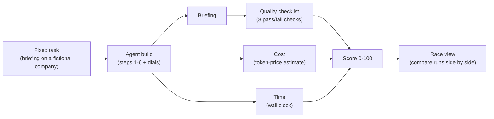
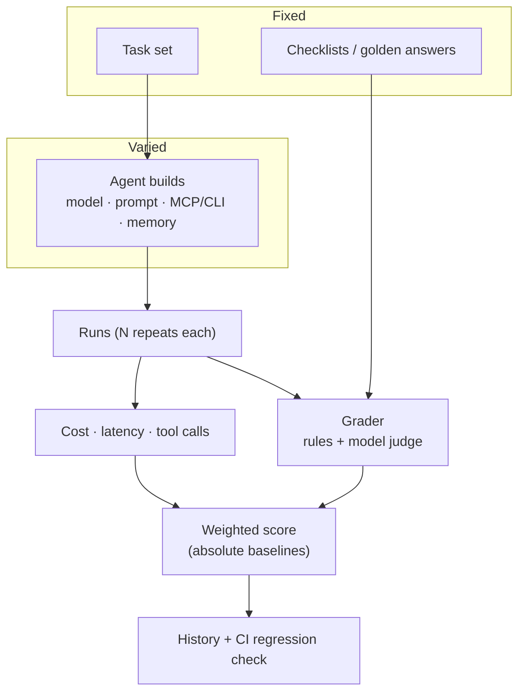

# Build agents that last: workshop results + a benchmarking framework for ClawBank

These are my notes and results from Anthropic's hands-on agent lab at **AI Native DevCon NYC (Nov 2, 2026)**. The second half is a **proposal** for reusing the same benchmarking pattern to evaluate agents built on [ClawBank](https://clawbank.co).

> **The lab's code is not in this repo.** Anthropic licensed it for workshop attendees only, so it stays on my machine. Everything here is written in my own words. Raw numbers are in [RESULTS.md](RESULTS.md).

---

## Contents
1. [What the lab is](#1-what-the-lab-is)
2. [How it works](#2-how-it-works)
3. [Our results](#3-our-results)
4. [Proposal: a ClawBank agent benchmark](#4-proposal-a-clawbank-agent-benchmark)

---

## 1. What the lab is

The lab uses one fixed task: write a short (~200-word) partner briefing on a fictional company's finances. The default company is *Tinplate Merchant Systems*. You build the agent for that task six ways, each one adding a single idea. Since the task never changes, any difference in the score comes from how the agent was built.

| Step | Build | Idea it teaches |
|---|---|---|
| 1 | Old-style prompt | A shouty, template-heavy prompt with everything stuffed into context. This is the baseline. |
| 2 | Better prompt | Give context and a goal instead of rules in capital letters. The output gets shorter and better aimed. |
| 3 | Research subagent | A cheaper model reads the source files and hands back facts, which keeps the lead agent's context small. |
| 4 | Tools via **MCP** vs **CLI** | The same small set of company-data tools, offered as MCP tools or as shell commands. |
| 5 | Memory + context management + caching | The first run saves research notes. Later runs write from those notes. Old tool results are cleared, and prompts are cached. |
| 6 | Your own build | Choose a starting point (any of steps 1–5) and adjust every dial. |

## 2. How it works



### Scoring

```
score = 100 x ( 0.5 x quality
              + 0.3 x (cheapest cost in race / this run's cost)
              + 0.2 x (fastest time in race / this run's time) )
```

- **Quality** is the share of checklist items the briefing passes, such as word count, required facts, and fitting on one screen. The checks are keyword and rule based, not an LLM judge.
- **Cost and time are relative.** The cheapest and fastest runs in the current race get full marks on those terms, and every other run is scored as a fraction of them.
- That means **scores are only comparable inside the same race.** A given run scores differently depending on which runs it's raced against. There's **no public leaderboard**: the lab doesn't send results anywhere, so a "95" in someone else's room and our "96" were measured against different baselines.

### The dials (step 6)

| Dial | Range / options | Trade-off |
|---|---|---|
| Start from | Step 1, 2, 3, 4 (MCP), 4 (CLI), 5 | Sets the agent's overall shape, and decides which of the dials below appear |
| System prompt | Editable | Clearer goals usually improve quality and shorten output |
| Company | Several fictional companies | Tests whether a build generalizes past one dataset |
| Main model | Sonnet / Haiku / … | Bigger models cost more and run slower. Once facts are gathered, a small model is often enough |
| Main effort | default / low / medium / high | More thinking can help quality but costs tokens and time |
| Researcher model | (steps 3+) | A cheap model is usually fine for reading |
| Research effort | low … high | Low is usually enough for gathering facts |
| Research turns | 2–16 | Too few and the researcher misses facts. Too many wastes budget |
| Passages per search | 1–10 (step 4) | Too few and buried facts get missed (we saw this happen). Too many bloats context |
| Tidy context at | 1k–40k tokens (step 5) | Clearing old tool results earlier saves tokens but can drop something still needed |
| Keep results | 0–5 (step 5) | How many recent tool results survive a clear |
| Prompt caching | on / off (step 5) | Turn it off to see how much caching saves |

## 3. Our results

Full table and notes: **[RESULTS.md](RESULTS.md)**. Scores below are from the single race that included every run, step 6 too.

| Run | Quality | Cost (est.) | Time | Score |
|---|---|---|---|---|
| 1 old-style prompt | 7/8 | $0.155 | 50s | 48 |
| 2 better prompt | 8/8 | $0.115 | 24s | 57 |
| 3 research subagent | 8/8 | $0.050 | 35s | 56 |
| 4 MCP tools | 7/8 | $0.037 | 38s | 50 |
| 4 CLI tools | 5/8 | $0.060 | 57s | 35 |
| 5 first run (research + save notes) | 8/8 | $0.034 | 51s | 55 |
| 5 second run (write from notes) | 8/8 | $0.025 | 12s | 66 |
| 6a step 5 from notes, Sonnet lead, low effort | 8/8 | $0.018 | 8.4s | 73 |
| **6b step 5 from notes, Haiku lead, low effort** | **8/8** | **$0.0019** | **10.2s** | **96** |

**Caveats**
- I ran this on a Claude subscription through the Agent SDK, not an API key. Costs are the lab's token-price estimates, not real charges.
- In that mode, step 5's context-clearing and explicit-caching dials **didn't take effect**, because Claude Code handles caching itself. Step 5 was rerouted through the SDK with the same prompts and logic.

**Lessons**
1. **Reusing memory matters most.** Once notes exist, the expensive research step is skipped entirely, and that was the biggest drop in both cost and time.
2. **Once research is cached, a cheap model is enough.** Writing from good notes is easy, so Haiku on low effort kept 8/8 quality at about a thirteenth of the cost.
3. **Prompt quality is free performance.** Going from step 1 to step 2 cut the output from ~2,000 words to ~250 and halved the time.
4. **Subagents shrink context.** The lead agent's context went from ~23k tokens to ~4k.
5. **MCP beat CLI here.** The CLI build paid for shell-tool overhead, had commands refused, and scored lowest.
6. **Tool output size is a quality dial.** The search tool's default of 5 passages missed one buried fact.

---

## 4. Proposal: a ClawBank agent benchmark

> **Status: proposal only.** Nothing below exists yet. None of the lab's code would be reused; this would be built from scratch.

The lab's method doesn't depend on finance briefings:



ClawBank (clawbank.co) offers a prediction-markets API and ClawBank OS, a harness for running companies at app.clawbank.co. The backend is Elixir/Phoenix, and agents reach it over MCP. That makes ClawBank a natural target: the work agents do there is concrete and checkable.

### Candidate tasks

| Task | What the agent does | Example checklist |
|---|---|---|
| Market Q&A | Answer "What are the odds on market X and when does it close?" | Calls the right market endpoint · reports the current price/probability · cites the correct close time with its timezone · doesn't make up markets |
| Company setup | Create a company in ClawBank OS and complete its first operating steps | Company exists via the API · required fields set · no duplicate created on retry · summary matches the actual state |
| Company operations | Run a defined workflow inside an existing company | Correct sequence of tool calls · state checked after each write · stays inside permission scopes |
| Support triage | Classify a support ticket and draft a reply | Correct category · cites the relevant doc or endpoint · no made-up balances or account details · tone and length limits |
| API onboarding | Walk a new developer through the clawbank-connect flow to a working API key | Steps in the right order · secrets never echoed · first test call succeeds |

### Builds to compare
- **Models:** large vs small lead model, plus a cheap researcher subagent.
- **Prompts:** baseline vs goal-oriented system prompt.
- **Tool surface:** ClawBank MCP server vs a CLI or raw HTTP wrapper.
- **Memory:** cold start vs saved notes (API docs, market metadata) carried over from earlier runs.
- **Effort / turn budgets:** low vs high.

### Improvements over the lab
| Lab | ClawBank benchmark |
|---|---|
| Keyword checklist | Rule checks **plus** golden answers and a model grader with a rubric. Where possible, verify against real API state |
| One run per build | **N repeats** per build, reporting the mean and variance (agents are nondeterministic) |
| Relative cost/time | **Absolute baselines** (fixed reference cost and latency), so scores stay comparable across days and people |
| No history | Results saved per commit. **CI flags regressions** when a prompt, tool, or model change lowers the score |
| No budgets | Hard **cost and latency budgets** per task. Going over a budget fails the run |
| Single task | A task set with weights, so one easy task can't dominate the score |

A possible score: `100 x (0.6 x quality + 0.25 x min(1, cost_budget / cost) + 0.15 x min(1, latency_budget / latency))`. A safety failure, such as a leaked secret or an unauthorized write, sets the score to 0.

### Suggested repo layout
```
clawbank-agent-bench/
├── tasks/            # one YAML per task: prompt, fixtures, budgets
├── checks/           # rule checks + golden answers + judge rubrics
├── builds/           # agent configs (model, prompt, tools, memory)
├── runner/           # executes builds against tasks, N repeats
├── grader/           # rule + model grading, safety gates
├── fixtures/         # sandbox accounts / seeded markets & companies
├── results/          # JSONL history, one line per run
├── dashboard/        # static report (could publish via GitHub Pages)
└── .github/workflows/bench.yml   # nightly + on-PR regression check
```

### Phased rollout
1. **Phase 1: Seed.** Two tasks (Market Q&A, Support triage), rule checks only, two builds (MCP vs CLI). Run locally against a sandbox.
2. **Phase 2: Grade properly.** Add golden answers and a model judge, N=5 repeats, absolute budgets, and a JSONL history.
3. **Phase 3: Widen.** Add the ClawBank OS company setup/operations and API onboarding tasks, plus memory and model comparisons.
4. **Phase 4: Gate.** A CI job runs on PRs that touch prompts, MCP tools, or agent configs, and fails if the score drops beyond a threshold. A nightly run tracks drift and publishes a static report.

---

*Workshop run and writeup by Justice Conder. Lab materials © Anthropic, not redistributed here.*
